# RL Race Car Tournament

AI drivers learn to race using neuroevolution and raycast sensors, then compete against each other on tracks ranging from a simple circle to a large grand prix circuit.

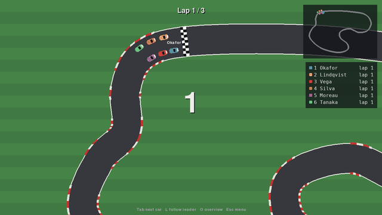

- **Tracks are data, not images.** Each track is a short list of points in a JSON file. The road, curbs, start grid and lap tracking are all generated from it.
- **Smooth AI driving.** A small neural network outputs continuous steering and throttle, so cars brake, take racing lines and cut corners.
- **Evolution across tracks.** Every generation is scored on several tracks, so the drivers generalize to circuits they have never seen.
- **AI-only races.** Drivers saved at different points in training race each other with a countdown, laps, live standings, car-to-car contact and a results screen.
- **Big tracks.** A follow camera and minimap handle tracks several screens wide.

Inspired by [alexkemp3038/reinforcement-learning-racing-game](https://github.com/alexkemp3038/reinforcement-learning-racing-game). I kept the core ideas (raycast sensors and a neuroevolution network) and rebuilt the rest from scratch to support multiple tracks, bigger tracks and racing.

<h1>Repository Structure</h1>

| File | What it does |
| --- | --- |
| `main.py` | Entry point. Runs the game loop and parses command-line flags. |
| `scenes.py` | The menu, free drive, training and race screens. |
| `track.py` | Loads a track from JSON, smooths it into a spline and handles lap distance and position lookups. |
| `car.py` | `Fleet`: every car on track as numpy arrays, with arcade physics and lap progress. |
| `sensors.py` | Vectorized raycasts plus the inputs fed to the network. |
| `brain.py` | The neural network, stored as one flat genome per car; saved as `.npz`. |
| `evolution.py` | Population, selection, crossover, mutation, and the multi-track `Trainer`. |
| `race.py` | Race rules: grid, laps, crashes and recovery, contact and standings. |
| `render.py` | Track drawing, camera, HUD, minimap and leaderboard. |
| `config.py` | All the tunable numbers in one place. |
| `tracks/` | `circle`, `oval`, `switchback`, `grand_prix`. |
| `pretrained/` | Drivers trained for 80 generations, so races work straight after cloning. |
| `tests/` | Track geometry, network, training and race tests (`pytest`). |

<h1>How to Run</h1>

```bash
python3 -m venv .venv
source .venv/bin/activate
pip install -r requirements.txt
python main.py
```

The menu lets you watch a race, train drivers, or drive yourself, and choose the track, laps and training options.

| Command | Does |
| --- | --- |
| `python main.py` | Opens the menu |
| `python main.py --race --track grand_prix --laps 3` | Goes straight to a race |
| `python main.py --train --track circle,oval,switchback` | Trains with a window open |
| `python main.py --train --headless --track all --gens 100` | Fast training with no window |
| `python main.py --drive --track switchback` | Drive yourself with the arrow keys |
| `pytest` | Runs the tests |

**Controls**
- **Training:** `F` cycles 1x/4x/16x speed, `R` toggles sensor rays, `O` switches between overview and follow camera.
- **Racing:** `Tab` cycles which car the camera follows, `L` follows the leader, `O` toggles overview.
- **Everywhere:** `Esc` goes back to the menu and `F12` saves a screenshot.

Training writes to `brains/`. Once that folder exists, races use your drivers instead of the pretrained ones.

<h1>How It Works</h1>

<h2>Tracks</h2>

A track file is a name, a road width and around 10–30 control points. On load, the points are run through a closed Catmull-Rom spline and resampled every 8px. That gives an evenly spaced centerline, and from it the left and right edges, the heading at every point, and the start grid.

To find where a car is, I project its position onto the nearest centerline segment. That gives two numbers: how far along the lap the car is, and how far it is from the middle of the road. If it's further than half the road width, it's off the track. This replaced the original pixel-mask collision and works at any track size.

<h2>Cars and sensors</h2>

All cars live in one `Fleet` object as numpy arrays, so a whole generation updates in a handful of array operations. The physics is arcade-style:
- Throttle accelerates and brakes, and rolling drag slows the car when coasting.
- Steering only works once the car is moving.
- The car loses some grip at high speed, so it can't take tight corners flat out.

The network sees 12 inputs:
- 9 rays fanned across 150° in front of the car (distance to the wall, 0–1)
- its speed
- the angle between the car and the road direction
- how sharply the road bends 150px ahead

It outputs steering and throttle, each between -1 and 1.

<h2>Evolution</h2>

Each brain is a 12 → 16 → 2 network flattened into a 242-number genome. Every generation, 40 cars drive, and the next generation is built from the results:
- The top 4 genomes are copied unchanged (elitism).
- The rest are children of two parents picked by tournament selection, with genes mixed by uniform crossover.
- Each child gets Gaussian mutation whose size shrinks over the generations, so early training explores and later training refines.

**Fitness** = laps completed (a continuous number, so 0.6 means 60% of a lap) + a bonus for finishing quickly − a small penalty for crashing. Cars are removed when they crash or stop making progress for 2 seconds.

<h1>Development Log</h1>

<h2>Step 1: A circle built from points</h2>

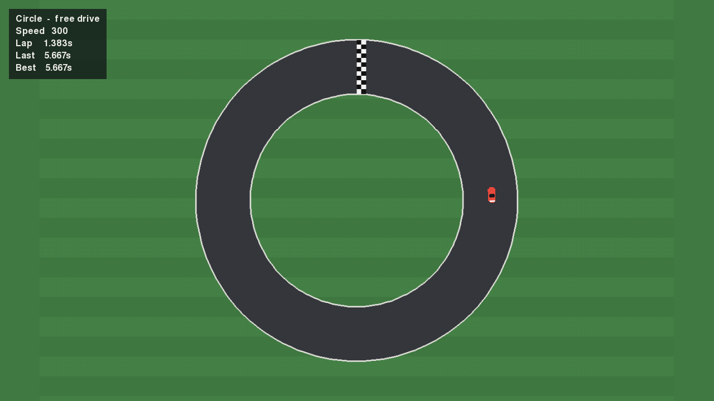

I started with the simplest possible track: 16 points on a circle. The original project drew its track as an image, hand-placed every checkpoint rectangle, and hard-coded the start position. That meant a new track was hours of work. I wanted adding a track to mean adding a JSON file, so everything else had to come from the points.

Options I considered for collisions:
- **Pixel masks (original approach).** Simple, but tied to an image of a fixed size, and slow to query for many cars.
- **Polygon tests against the road outline.** Exact, but doesn't tell you how far around the lap you are.
- **Distance to the centerline (chosen).** One projection gives both "am I on the road?" and "how far along the lap am I?".

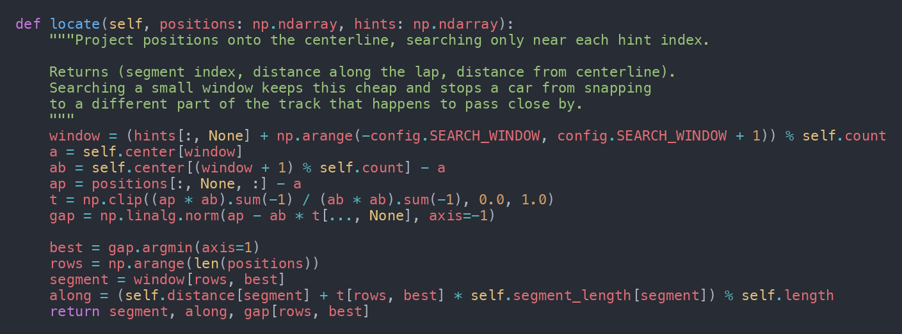

The search only looks at a small window of segments around where the car was last frame. That keeps it fast and stops a car snapping to another part of the track that happens to run close by.

For laps I track *unwrapped* progress: the distance travelled along the lap, which keeps counting past the finish line instead of resetting. Driving backwards makes it go down, so reversing over the line can never count as a lap. The original project needed special finish-line direction checks for this.

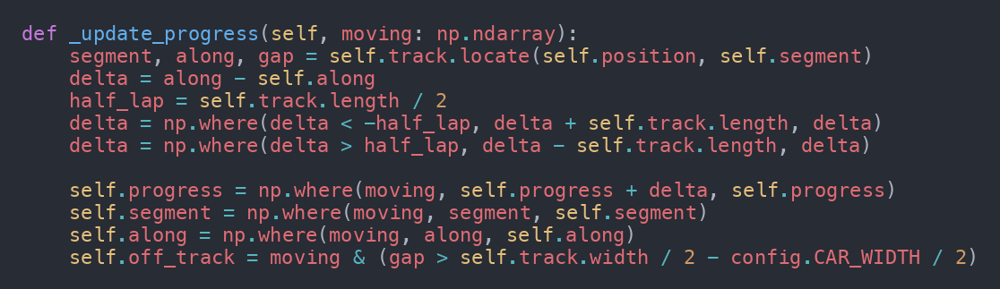

**Challenges**
- **The grass didn't fill the window.** The circle's background surface was a little taller than the screen, so the camera zoomed out to fit it and left gaps at the sides. I changed the fit zoom to be based on the track itself, and padded the background so it still covers the screen after zooming.
- **A lap distance of 4289.1 instead of 0.** A point on the start line could match the *last* segment at its very end, giving the full lap length rather than zero. I wrap the value with a modulo now, and the test compares distances around the loop.

<h2>Step 2: Teaching cars to drive the circle</h2>

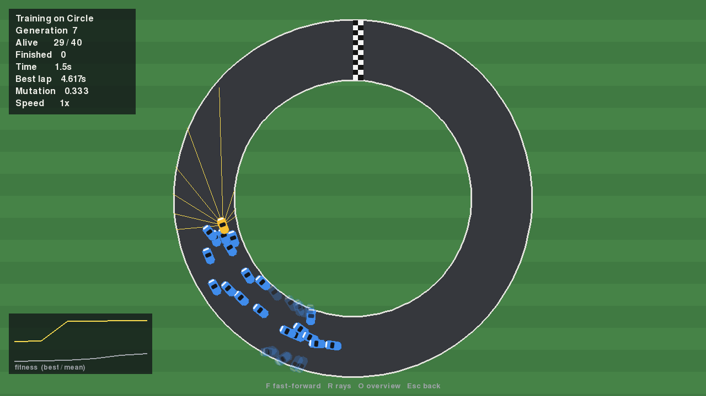

Next came sensors, the network and evolution. The original network turned outputs on or off at a threshold (press forward / don't press), which made driving jerky. I switched to `tanh` outputs used directly as steering and throttle, so a car can steer a little or brake gently.

The original also ran the forward pass in nested Python loops, one car at a time. Here each brain is a flat genome and the whole population runs as one batched `einsum`:

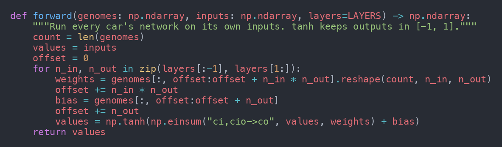

The raycasts are vectorized the same way: every ray of every car is tested against nearby wall segments in one go.

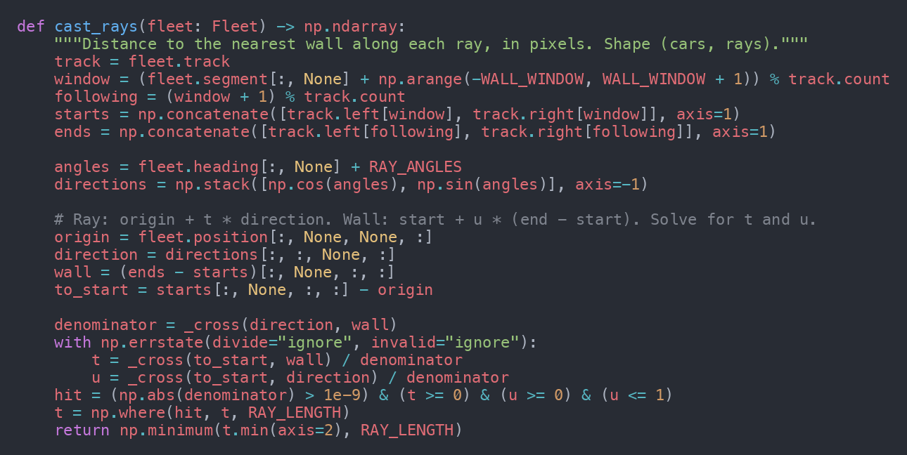

For saving I went with `.npz` instead of pickle. A brain is just an array, so pickle's ability to store any object isn't needed. Pickle is also unsafe to load from untrusted files and breaks whenever a class changes. The file also stores the layer sizes, so loading a brain trained with a different network shape gives a clear error.

**Challenge: the circle was too easy.** A car finished a lap in generation 1. After 25 generations (about 15 seconds of headless training) the best lap was 4.20s, close to the 4.03s you'd get going flat out around the centerline. Once each heat ran two laps (Step 3), the flying lap dropped to 3.37s, because the cars learned to cut to the inside of the circle. A circle was never going to show whether the AI could actually *drive*, so the next step was harder tracks.

<h2>Step 3: Bigger, harder tracks, and drivers that generalize</h2>

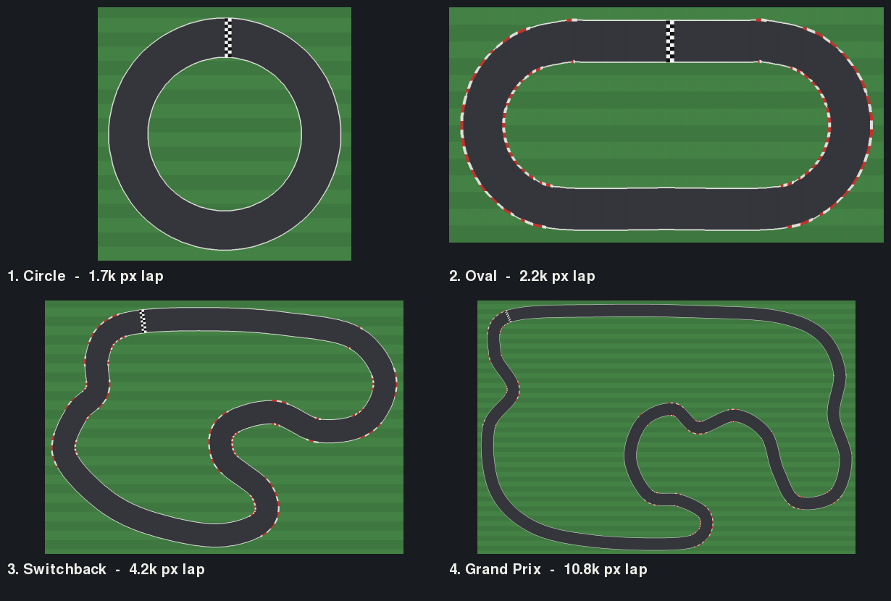

Because tracks are just points, building up from the circle was quick: an **oval** with straights and tighter ends, **Switchback** with S-bends and a hairpin, and a **Grand Prix** about three screens across in each direction. The bigger tracks needed a follow camera and a minimap.

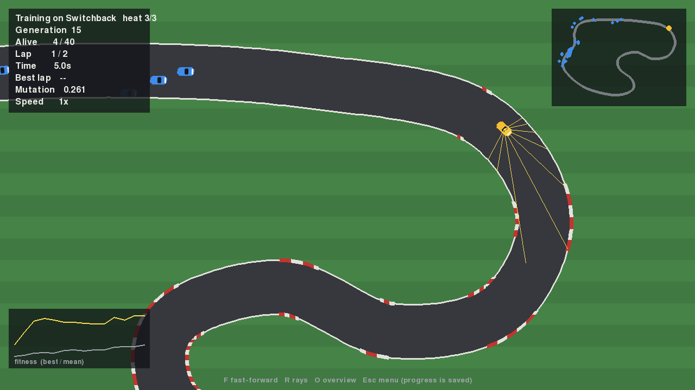

**Challenge: corners too tight to drive.** I added a geometry test that checks every corner's radius is wider than half the road. Any tighter, and the inside edge folds over itself. It failed straight away on Switchback and the Grand Prix. I printed which control points were nearest the bad corners and moved them. One corner on Switchback wouldn't get fixed by hand, so I wrote a small grid search over two control points, which raised its minimum radius from 44px to 67px. A second test checks that no two parts of a track come close enough to overlap.

**Challenge: overfitting to one track.** A driver trained only on Switchback for 60 generations set a 10.87s lap. When I tested it from four different start points:

| Trained on | Circle | Oval | Switchback | Grand Prix (never seen) |
| --- | --- | --- | --- | --- |
| Switchback only | 4/4 | 1/4 | 2/4 | 0/4 |
| All three, one track per generation | 4/4 | 2/4 | 3/4 | 0/4 |
| All three every generation, 2-lap heats | **4/4** | **4/4** | **4/4** | **3/4** |

My first fix was rotating to a different track each generation. That let lucky specialists win, because a brain only had to be good on whichever track came up. The version that worked runs every generation on *every* training track in turn ("heats") and averages the fitness. To win, a brain has to drive well everywhere.

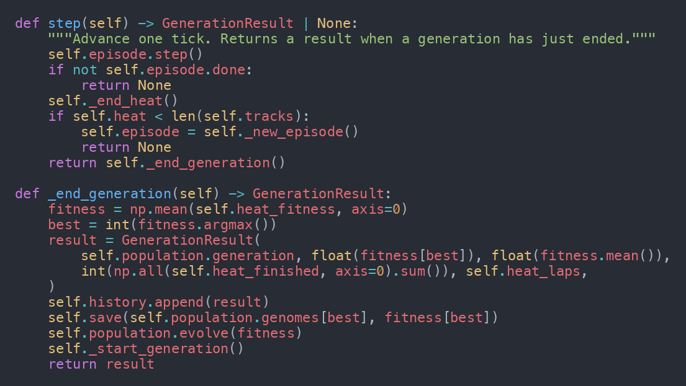

**Challenge: a crash that kept happening in the same spot.** Even with heats, two different start points on the oval crashed at exactly the same corner, 40% of the way around the lap. The cause turned out to be physics, not luck. At top speed the car's tightest possible turn has a radius of 420 / (3.2 × 0.6) ≈ 219px, but the oval's corners are 200px. The drivers had never learned to brake. They only got through when they happened to arrive on the right line, and a single lap from a standing start hid this.

The fix was making each heat two laps. The second, flying lap arrives at every corner at full speed, so drivers that can't brake get filtered out. That's the last row of the table above: 4/4 on every training track, and 3 of 4 starts on the Grand Prix it never trained on, at 25.8s (going flat out the whole way would take about 25.75s).

Two laps per heat broke the lap times too. The reported time had become the total for both laps, so I added a per-car lap timer that keeps each car's best single lap.

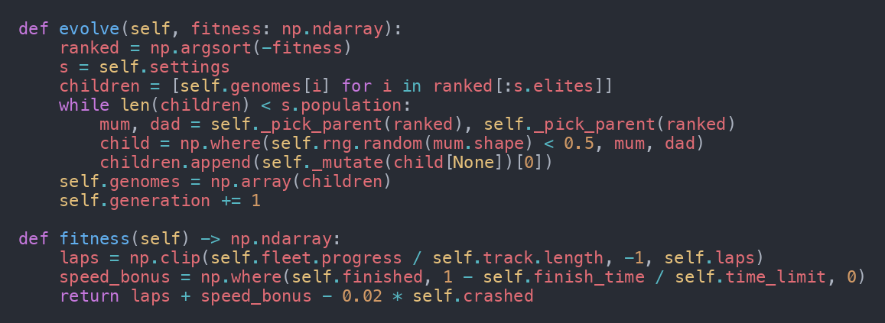

<h2>Step 4: Racing</h2>

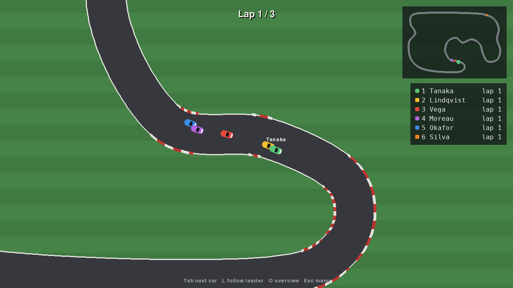

Training saves a snapshot of the best brain every 5 generations. A race takes the champion plus snapshots spread across training, and gives each a name and color. Older snapshots are slower and crash more, which gives a natural spread of skill without hand-tuning any opponents. In races:
- Crashed cars are put back on the racing line and parked for a second rather than eliminated.
- After the winner finishes, the rest of the field gets 15 seconds before the results screen.

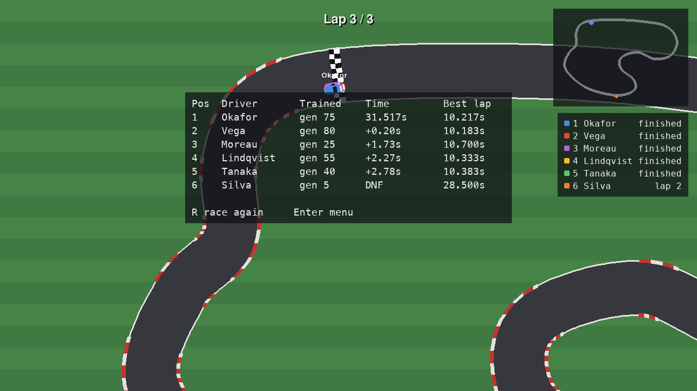

**Challenge: nobody could overtake.** In the first version, cars drove straight through each other, so the field ran in single file and positions never changed. I added simple contact: overlapping cars get pushed apart, and the car behind loses a bit of speed, so passing means finding room.

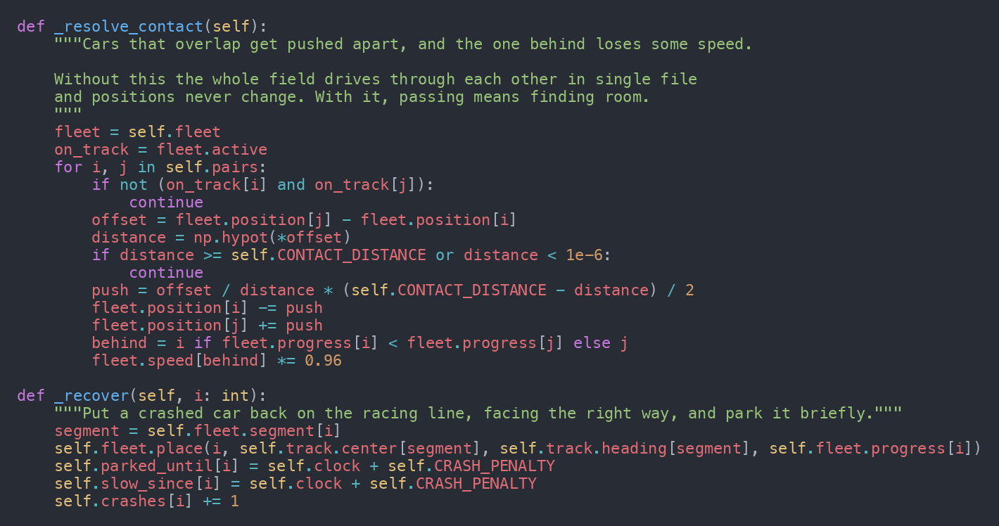

**Challenge: the grid decided every race.** I'd started with a reverse grid, with the best driver at the back to force overtakes. On the oval, the generation-25 driver starting at the front won, and the generation-80 champion finished fifth. Trained drivers are within a few tenths of each other and take almost the same line, so starting order mattered more than skill. I switched to a shuffled grid, so every restart (`R` on the results screen) is a different race. Skill still shows over a full race: the generation-5 driver crashes 10–30 times and never finishes.

<h2>Step 5: Polish</h2>

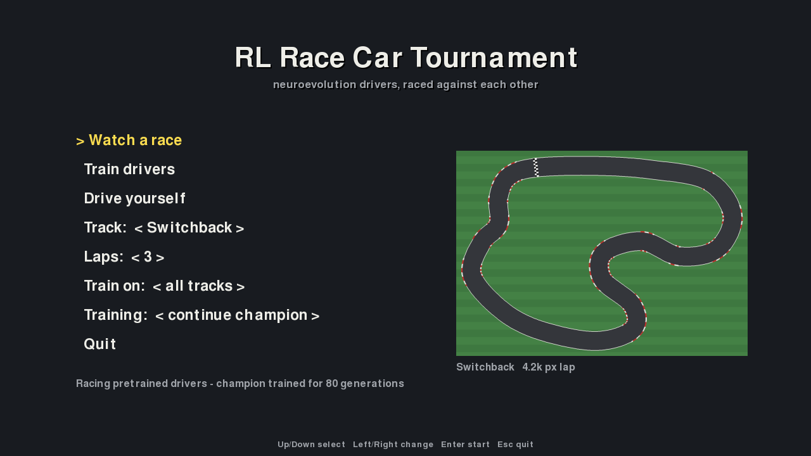

- I replaced the original's terminal prompts with an in-game menu that shows a preview of the selected track.
- Pretrained drivers ship in `pretrained/` (68 KB in total), so races work right after cloning.
- Curbs only appear on tight corners: wherever the radius drops below 220px.
- The training HUD shows the heat, the lap, the mutation size and a best/mean fitness graph.
- Training can run headless for bulk generations, or with a window at up to 16x speed.

<h1>What I'd Do Next</h1>

- A track editor: click to place control points, with the geometry tests checking the result live.
- Qualifying laps to set the grid, plus tyre wear or fuel to bring strategy into longer races.
- Feed the network nearby cars (rays that see other cars), so overtaking becomes something it learns rather than something contact forces.
- Compare neuroevolution against a gradient-based method like PPO on the same sensors.
